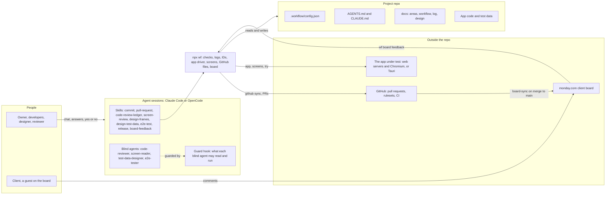
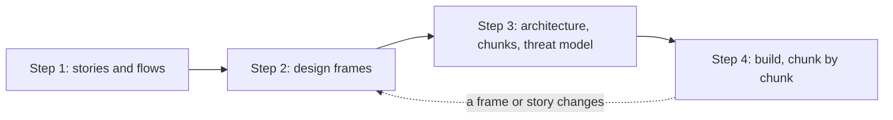
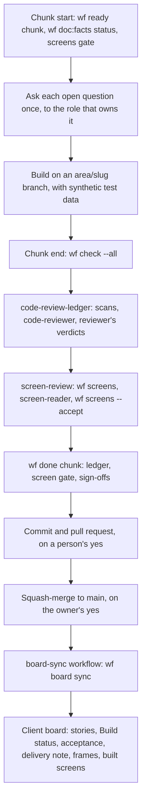
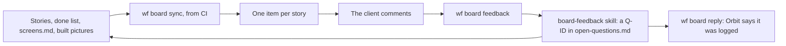

# Overview

How the pieces of the workflow kit fit together, for a person or an agent new to a project that uses it. Each section names the doc that has the detail.

## The pieces

The kit has three parts that work on one project repo:

- **The plugins.** Skills, blind agents, and a guard hook for Claude Code, also shared with OpenCode. They hold the judgement: when to ask, how to review, how to draw a frame.
- **The `wf` command.** `npx wf ...`, installed as the `freeorbit-workflow` package and pinned to a tag. It holds the facts and the mechanics: checks, logs, the next ID, the app driver, GitHub files, and the client board.
- **The docs.** `wf docs sync` writes the workflow docs, this one included, into `docs/workflow/`, and `AGENTS.md` and `CLAUDE.md` into the root. The project's own parts sit between `wf:local` markers and survive each sync.

- `.workflow/config.json` drives everything. `npx wf config` prints the project's settings over the kit's defaults, each with its reason, and [config.md](config.md) lists them.
- The skills call `wf` for anything that can be counted or checked, so a model judges facts instead of re-deriving them.
- A blind agent sees only what its prompt allows, so its finding is not shaped by the code or the frame it checks. The guard hook enforces that.

## The plugins

| Plugin | What it adds | Detail |
| --- | --- | --- |
| core | The guard, the commit, pull-request, doc-find, handoff, workflow-init, workflow-doctor, and board-feedback skills | [ai-tools.md](ai-tools.md), [branches.md](branches.md) |
| review | The `code-review-ledger` skill and the read-only `code-reviewer` agent, with the findings ledger | [code-standards.md](code-standards.md) |
| design | Frames as HTML or exported PNG, their review pictures, and the screen review with the `screen-reader` agent | [four-steps.md](four-steps.md#step-2-design-frames) |
| testdata | The `test-data-designer` agent and a seeded generator, so development never uses real personal data | [test-data-process.md](test-data-process.md) |
| e2e | The `e2e-tester` agent, which follows the stories through the running app | [test-data-process.md](test-data-process.md) |
| stack-web, stack-tauri-rust | How `wf app` drives a web app, or a Tauri and Rust app | [tools.md](tools.md) |
| release | The release skill and the project's release commands | [releasing.md](releasing.md) |

## An area's four steps

Each area of the product goes through the four steps on its own. A later step can send the work back to Step 2.

- Step 1 writes the area's `user-stories.md` and `user-flows.md`. No screens and no stack yet.
- Step 2 draws a frame for each screen and lists it in `screens.md`, with the stories it shows and the Reach that opens it in the app.
- Step 3 picks the stack, answers the open questions, and adds the area's chunks to the build order.
- Step 4 builds the chunks in that order. The detail is in [four-steps.md](four-steps.md) and [build-order.md](build-order.md).

## A chunk, from start to client

A chunk is a few whole stories, built, checked, reviewed, and merged together. Smaller changes take the quick track, and a new area takes the area track, as in [four-steps.md](four-steps.md#tracks).

- Nothing is committed to `main`. The branch hooks from `wf hooks install` refuse it, and the ruleset from `wf github ruleset` backs that up.
- `wf signoffs` keeps a merge waiting while a question under the chunk's heading has no answer from its role.
- The chunk's row moves to the done list with a "For the client" sentence, which the board posts once its stories are built.

## The client board

The board shows the stories one way, from the repo to monday.com. The repo stays the source of truth, and the client's say comes back as open questions.

- Build status is the repo's, and the last label is Built. Client review belongs to the people and is never synced.
- The token is a person's own. CI reads it from the `board` GitHub Environment, limited to `main`, and a local run reads it from the environment or a gitignored `.env`.
- `board.show` switches each extra on or off: delivery notes, frames, built screens, and client questions.

## Where things are kept

| What | Where |
| --- | --- |
| Settings | `.workflow/config.json`, and its schema beside it |
| Rules every chat follows | `AGENTS.md`, with the Who decides block from `people` and `decisions` |
| An area's stories, flows, screen list, and architecture | The area's folder, from `areas` in the config |
| Frames and their pictures | `design.frames` and `design.review`; accepted built screens in `design.built` |
| Where the work stands | `docs/log/build-order.md` and the done list, through `wf doc:facts status` |
| Agreed decisions | `docs/log/decisions/`, through `wf decision add` |
| Open questions | `docs/log/open-questions.md`, one table per chunk, through `wf question add` |
| Review findings | The findings ledger, through `wf ledger` |
| Issues hit and their fixes | `docs/log/troubleshooting.md` |
| Synthetic test data | The area's `test-data/` folder and the generator in `testdata.dir` |

## Commands by moment

| Moment | Commands |
| --- | --- |
| Setting up | `wf init`, `wf doctor`, `wf tools`, `wf hooks install`, `wf docs sync`, `wf ai:sync`, `wf github sync` |
| Finding things | `wf doc:find`, `wf doc:facts`, `wf config`, `wf roles` |
| Starting work | `wf ready <track>`, `wf screens --gate`, `wf question add`, `wf decision add` |
| Building | `wf app`, `wf try`, `wf testdata`, `wf design render`, `wf check` |
| Ending a chunk | `wf scan`, `wf ledger`, `wf screens`, `wf done <track>`, `wf signoffs` |
| Releasing | `wf release` |
| The client board | `wf board setup`, `wf board plan`, `wf board sync`, `wf board feedback`, `wf board reply` |
