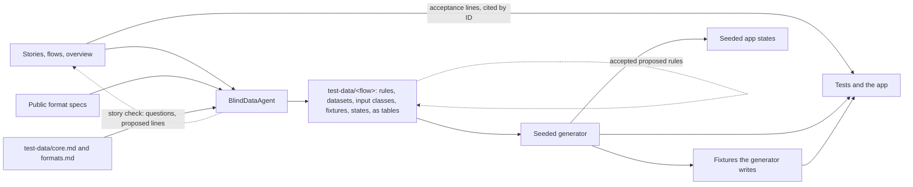

# Test data

How the project's synthetic test data is designed, made, and kept in step with the stories. It applies to every area that uses it.

<!-- wf:local intro -->

## The idea

Test data has two authors who never share context.

- **The stories say what to test.** A story's acceptance lines are its checks, each with an ID by its place, such as `GM-07.3`. A test or a scenario cites the line it proves.
- **The blind side designs the data.** A data-design agent, the kit's `test-data-designer`, writes the spec: what data a run needs to show those lines. It writes no checks.
  - It reads the area's `overview.md`, `user-stories.md`, `user-flows.md`, its test-data rules, and public format specs.
  - It never reads code or architecture, so the data does not copy the implementation's assumptions.
  - A story check reads changed stories and returns a few ranked questions, and at most two acceptance lines a story that it thinks the story forgot, for the story's owner. It is cheap, so it runs whenever stories change.
  - A first draft writes the area's `test-data/` folder: personas, datasets, rules, journey states, input classes, and edge cases, as tables tied to story IDs and rule IDs, one flow area per file or folder.
  - It covers the stories of this chunk and the next. A later chunk's flow areas are written when it starts, so no spec is refreshed for code not yet begun.
  - A refresh reads the changed stories, `core.md`, and only the area files those stories reach. It returns only the rows to add or edit, each naming its file, or says the spec already covers the change.
- **The code side makes it.** The project's seeded generator implements that spec, including the edge fixtures. The same seed gives the same bytes, so a failing test fails the same way every time. Development and tests use that output.

<!-- wf:local generator -->

## Budgets

The designer's volume is counted by the tool, not left to its judgement: a budget goes into its prompt, its return is held to caps, and a refresh that takes a story over its fixture cap does not close. The `design-test-data` skill has the three commands. An exception is the owner's, named in `testdata.limits.allow`.

An AI does not write the data files itself. Data written by a model cannot be reproduced, goes wrong at scale, and costs a model call every run. The agent writes the spec. Code writes the data.

Blindness is kept by the agent's instructions, and checked at review: the spec cites only story IDs, flows, and public specs. A line that names a table, a function, or a code file sends the spec back.

## Area rules

Each area touches different personal data, so the generic guardrails below are not enough. A photos area would need generated images with no faces. A password area would need secrets that cannot be mistaken for real ones.

Those rules live in the area's `test-data/` folder, each with an ID, a category from the kit's list or `testdata.categories`, and a Type.

- The owner accepts `product` rules one by one and `safety` rules as one list.
- The team accepts `craft` rules a category at a time.
- In a solo project that is one page, with the craft rules as one row.

The designer writes `craft` and `safety` rules. How the app behaves is the stories' to say, so it proposes that as an acceptance line.

They are not passed in the agent's prompt, because the agent running the skill has seen the code and could leak it.

Where the rules come from depends on the project's kind, as [project-kinds.md](project-kinds.md) says. A domain product's rules about its domain come from its sources and an outside owner, through Step 0, not from the designer.

## The folder

An area's test data is the `test-data/` folder in its docs folder, one flow area per file, so a story change touches only the files that cover it. The shape of each file, table, and category is in [test-data-formats.md](test-data-formats.md).

- **About a page a file.** A flow area that fits in about 100 lines is one file. One past it becomes a folder of files of up to about 100 lines: rules, data, states, gaps, and a topic file per part, with its input classes and edge cases. The index takes one row, for the folder's README.
- **Rules sit beside their data.** A rule about one flow area is in its rules table, and a rule two need is in `core.md`. Each row has an ID, a category, its stories, and the day the reviewer accepted it.
- **Risk decides depth.** Every story gets its datasets and states. Input classes and edge-case fixtures are only for what is high-risk: an acceptance line that ends `Risk: high (<why>)`, or a story whose own Risk line says high.
- **Risk is rationed.** Tag the line, not the story. `npx wf doc:check` warns when more than `testdata.limits.highShare` of an area's acceptance lines are high, since a tier most stories have says nothing.
- **The owner reviews what is theirs.** Product rules and safety rules, in plain words, with the area's `glossary.md`. The team reviews the craft rules. `npx wf testdata review <area>` builds each page.
- **Classes once.** The classes of an input, such as a pasted address or an imported file, are listed once, for the input, and tested once, where its rule lives.
- **Fixtures few.** Edge-case fixtures are only for what a flow alone can show: five for a high-risk story, two for each high-risk line, none for a low-risk story.
- **A story reaches the files that name it.** `npx wf testdata route <area> <ids>` lists them, from their `Covers` lines, rule tags, and other mentions. A refresh reads `core.md`, `formats.md`, and only those.
- **Areas follow the flows**, which change less than the stories. A story in two flows reaches two files. Dataset ids, fixtures, and states are unique across the folder, so one file can name another's.
- **An area stays reviewable.** The refresh that touches an area proposes the split or the merge that `npx wf doc:check` warns for:
  - a file past `testdata.limits.lines`, or a flow area past `testdata.limits.areaKB`;
  - a folder that would fit in one file (`folder`), or a file too small to stand alone (`small`), each with the `wf testdata merge` or `fold` command that does it;
  - fixtures past `testdata.limits.fixtures`.

  A file not yet split goes on `testdata.limits.loose` until it is.
- **Spec and code point at each other.** A test cites the acceptance line or the rule it proves, such as `// GM-07.3` ([ids.md](ids.md)). `npx wf testdata trace [area]` lists the spec rows no code names, and the tests that name no row and no story.
  - A row may wait for its chunk, and a test of plain code needs no row; each is judged, nothing fails.

<!-- wf:local folder-checks -->

The rules are never written from scratch by hand:

1. The data designer drafts `core.md` and `formats.md` once, in rules mode, from the overview and stories. The owner reviews the product and safety rules, and the team the craft rules, a category at a time.
2. When the data designer writes or refreshes the spec, any rule it had to assume goes in the area's `## Proposed rules`. At review, the owner accepts or drops the safety ones, with any product rule from an older spec, and the team the craft ones. Accepted rows move into that file's rules table, or `core.md`.
3. The owner can drop a rule at any review, as not worth testing: the Drop verdict, applied with `npx wf testdata drop`. It needs no proposal, since the owner decides it.
   - It goes in the area's `## Dropped` table.
   - The code that cited it loses the citation, or the test when proving that row was all it did.
4. A change to an accepted rule is proposed too, with Accepted `edit` and the rule's own ID, and never made in place. Accepting it replaces the row and sets Accepted to that day, so the date always covers the words. A test that shows a rule is wrong gets a `dispute` row, as a check does.

Where an area rule is stricter or more specific than a generic one, the area rule wins.

## Kinds of data

Fixtures are small committed files for the edge cases the spec names. Generated datasets are the profiles and named sets the spec gives, written when a test or a scenario needs them and never committed. Seeded app states start the app at a journey point. Fake services stand in for real ones.

Input classes are not fixtures: a test reads their values from the spec's table, or restates the table as its own, and stores no file.

<!-- wf:local kinds -->

## Guardrails

- **Reserved domains for people.** Every person, including the user, uses a reserved domain: `example.com`, `example.org`, `example.net`, or a `.test` or `.invalid` name (RFC 2606, RFC 6761). Service senders may use real public service domains.
- **No real data folder.** Agents and tests use a throwaway data folder, never the user's, unless the owner asks.
- **No generated output in git.** Generated datasets go to ignored folders.

<!-- wf:local guardrails -->

## Per area

1. **When stories change**, at any step, the blind agent's story check returns its questions and proposed lines. The story's owner answers them, and tags each high-risk acceptance line.
2. **At Step 3**, run the blind agent for the area, as the `design-test-data` skill says: first in rules mode for `core.md` and `formats.md`, then in spec mode for the rest. The reviewer reviews both like a story file, and the same day `npx wf testdata covered` records every story's acceptance hash.
   - A later story edit does not start the agent. It makes the story stale: its acceptance no longer has the hash the coverage file holds.
   - **When.** Stale stories are refreshed in one run, at the start of the chunk that builds them or the chunk before. A change to a story the current chunk builds is refreshed before the work that depends on it. The reviewer can ask for a refresh at any time.
   - **How.** `route` names the area files those stories reach. The agent reads `core.md`, `formats.md`, and those files, and returns a delta. The main agent applies it and runs `refresh-close`.
   - **Review.** The refresh is reviewed in the chunk-start question in [four-steps.md](four-steps.md#chunk-start), not in a separate round: the owner sees only their rows and one line for the rest.
3. **In each chunk of Step 4**, teach the generator the data that chunk needs, before or with the code: a scenario for each new journey point, support for each dataset and profile the spec gives that chunk, and a writer for each edge fixture. Then develop and test against what it writes.
4. **When a test shows an acceptance line or a rule is wrong**, add a `dispute` row to the area's gaps table naming it, with what the test found and no code. Do not edit it to make a test pass. The next refresh answers it, and its owner reviews that edit like any other.
5. **When the spec or the rules change**, update the generator in the same change, regenerate the fixtures, and point the tests and the scenarios at that output. A test that still expects the old bytes is updated to the new output.

The spec lists data by story. A story's data is due in the chunk that builds the story. Data for a later chunk can wait.

<!-- wf:local drift -->

## What uses it

The app, a test, and a scenario all read data the generator produced. A test does not assemble its own copy of a dataset. That second copy drifts from the spec, and a later spec change never reaches it.

<!-- wf:local uses -->

## When the spec or the format changes

A refresh that says no change does not start this list.

1. If the spec changed, set its `Updated:` line to that day.
2. Update the generator so the dataset or fixture matches. A format change with no spec edit still starts here.
3. Regenerate the committed fixtures. A project whose generator fingerprints the spec leaves out `## Rules` and `## Gaps`: an accepted rule or a gap or dispute row is a question for the next refresh, not a change the generator must follow.
4. Run the tests and the app from that output. Add a scenario when the chunk needs to open the app on that data.

<!-- wf:local change-steps -->

## Check rows from before v0.69.0

Until v0.69.0 the designer also wrote checks, `C-GM-41`, in tables beside the data. Those tables are still read, and a test that cites one still names it. Nothing gates, budgets, or reviews them, and none is added.

`npx wf testdata prune <area>` takes out the check rows no code cites, for stories already built. It is a dry run until `--write`, and never touches a rule, a fixture, or an input class.

<!-- wf:local building -->
