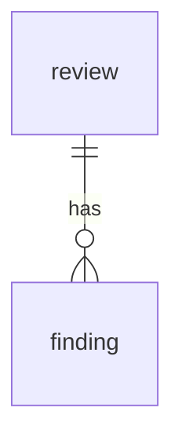

<!-- wf:template data-model: drafted in the area's Step 3, before its first build chunk, then reviewed by the owner with the architecture. Delete this line once the draft is reviewed. -->
# <Area>: data model

What this area keeps, how it is shaped, and what removes it. The first build chunk writes the schema and its migrations from this, and the code review checks them against it and the project's data standards. It is a design, not the SQL.

An area that keeps nothing of its own says so in one line instead of the sections below, such as "This area stores nothing: it reads the document register's tables through its API."

## At a glance

What a reader needs before any table, in eight bullets or fewer.

- **Store.** <Postgres, SQLite in the app's data folder, or files>, following the project's data standards and its <engine> conventions.
- **Size.** <N tables in M parts>, the largest <table>, at about <rows> rows.
- **Main things kept.** <The three to five entities the stories turn on, in their words, such as a review and its findings.>
- **Who else reads it.** <Another area or core, through what; or nobody.>
- **Deleting.** <What one delete takes with it, in a line; the details are under Keeping and deleting.>
- **Exceptions.** <Each place this model breaks a data standard, by its rule ID, with why; or none.>

## Parts

Each part is the tables one feature keeps, in the order a user meets them. A model of more than about 25 tables keeps each part in its own file beside this one, `data-model/<part>.md`, and lists them here.

| Part | What it keeps | Tables | Stories |
| --- | --- | --- | --- |
| <Reviews> | <Each review and what was found in it> | <review, finding> | <APP-01, APP-02> |

## <Part>

One sentence: what this part keeps, and why the stories need it.

A part's diagram shows its own tables and the keys between them, ten or fewer; a table of another part is named in a note, not drawn.

### review

One sentence: what one row is, in the stories' words.

| Field | Type | Null | Key or constraint | Notes |
| --- | --- | --- | --- | --- |
| id | <the standards' key type> | no | primary key | |
| title | text | no | check length 1 to 200 | |
| created_at | <the standards' instant type> | no | | |

### finding

One sentence: what one row is.

| Field | Type | Null | Key or constraint | Notes |
| --- | --- | --- | --- | --- |
| id | | no | primary key | |
| review_id | | no | foreign key to review, on delete cascade | |
| summary | text | no | | |

### Single rows

The part's tables that hold one row each, such as a setting or a checkpoint, in one table rather than a section each.

| Table | What its one row says | Fields |
| --- | --- | --- |
| <scan_progress> | <How far the scan got> | <messages, finished> |

## Indexes

Each query a hot path runs, and the index it needs, from the hot-paths doc `review.hotPaths` names.

| Query | Index | Hot path |
| --- | --- | --- |
| <the reviews a person sees, newest first> | <review (owner_id, created_at desc)> | <its name> |

## Sensitive data

Each field that is personal, secret, or the client's own, and how it is kept, from the threat model `review.threatModel` names.

| Field | Why it is sensitive | How it is kept |
| --- | --- | --- |
| <person.email> | <personal> | <plain, readable by the app's role only> |

## Keeping and deleting

- **How long.** <How long each part's rows are kept, and what removes them.>
- **Deleting.** <What a delete takes with it, so nothing the story says is gone stays behind: child rows, files, copies, backups.>

## Migrations

- **How they run.** <The tool, such as the stack's migrations folder, and when they run: on deploy, on the app's start.>
- **A large or busy table.** <How a change avoids copying it whole or locking it for long, such as adding a column with no default, then filling it in batches.>
