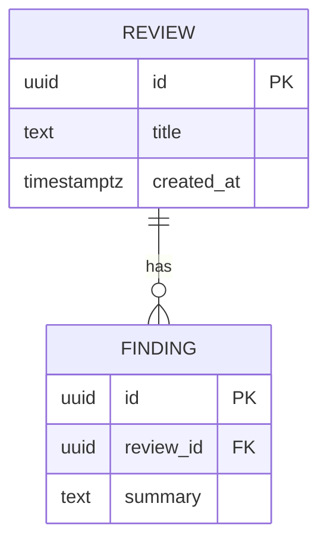

<!-- wf:template data-model: drafted in the area's Step 3, before its first build chunk, then reviewed by the owner with the architecture. Delete this line once the draft is reviewed. -->
# <Area>: data model

What this area keeps, how it is shaped, and how it changes. The first build chunk writes the schema and its migrations from this, and the code review checks them against it. It is a design, not the SQL.

An area that keeps nothing of its own says so in one line instead of the sections below, such as "This area stores nothing: it reads the document register's tables through its API."

## Where it lives

<The store, such as a Postgres database, SQLite in the app's data folder, or files, and why; who else reads or writes it. A choice between stores is the owner's, asked on an ask page.>

## Entities

<A line per entity: what one row is, in the stories' words, and the stories that need it.>

## Tables

### <table>

| Field | Type | Null | Key or constraint | Notes |
| --- | --- | --- | --- | --- |
| id | uuid | no | primary key | |
| <field> | <type> | <yes or no> | <unique, foreign key to …, check …> | <what it holds, its unit, its limits> |

## Indexes

Each query a hot path runs, and the index it needs, from the hot-paths doc `review.hotPaths` names.

| Query | Index | Hot path |
| --- | --- | --- |
| <the reviews a person sees, newest first> | <reviews (owner_id, created_at desc)> | <its name> |

## Sensitive data

Each field that is personal, secret, or the client's own, and how it is kept, from the threat model `review.threatModel` names.

| Field | Why it is sensitive | How it is kept |
| --- | --- | --- |
| <users.email> | <personal> | <plain, readable by the app's role only> |

## Keeping and deleting

- **How long.** <How long each table's rows are kept, and what removes them.>
- **Deleting.** <What a delete takes with it, so nothing the story says is gone stays behind: child rows, files, copies, backups.>

## Migrations

- **How they run.** <The tool, such as the stack's migrations folder, and when they run: on deploy, on the app's start.>
- **A large or busy table.** <How a change avoids copying it whole or locking it for long, such as adding a column with no default, then filling it in batches.>
